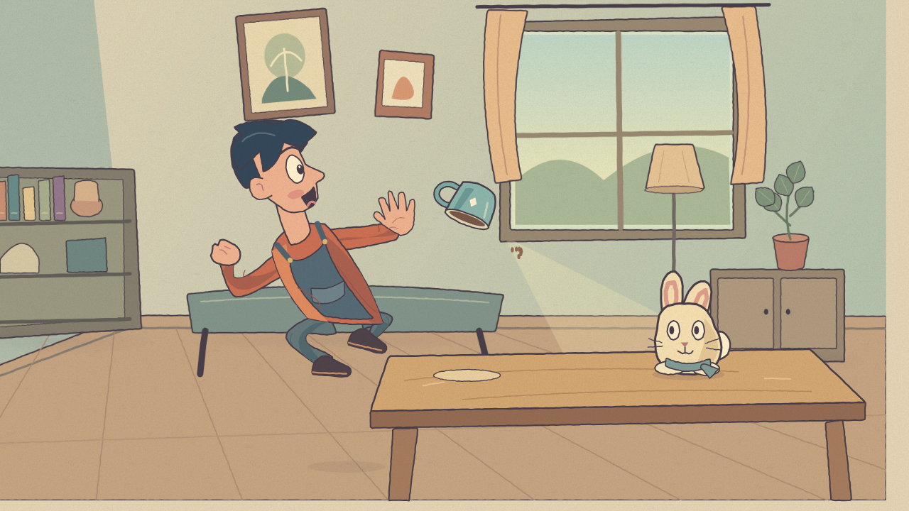
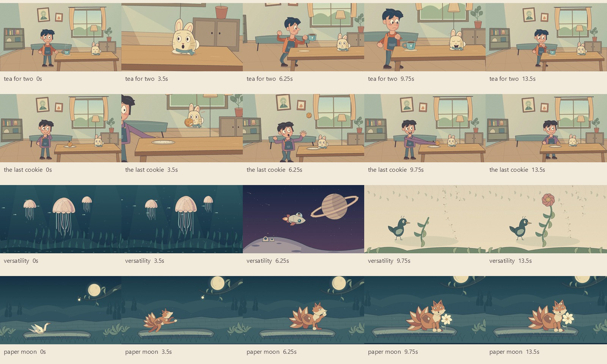

# Bamboonimation

**Desenhos animados 2D, escritos em Python.**

Um framework de animação para pessoas e agentes de IA que querem controlar desenho, atuação, tempo e câmera por código. Crie personagens originais com curvas vetoriais, organize cenários em camadas e renderize localmente com Skia e FFmpeg. O assunto é livre: pessoas, animais, máquinas, mundos abstratos, histórias, fantasia ou qualquer outro conteúdo 2D que você desenhar ou fornecer como asset. Os personagens dos exemplos são pontos de partida opcionais, sem restringir o tipo de animação.

[](assets/gallery/tea_for_two.mp4)

[Começar](#instalação) · [Primeira cena](#sua-primeira-cena) · [Exemplos](#curtas-de-exemplo) · [Guia para agentes](docs/agent-guide.md) · [Arquitetura](docs/architecture.md) · [Qualquer universo 2D](docs/versatility.md) · [Validação](docs/validation.md)

> **Licença não comercial.** O código está disponível sob [PolyForm Noncommercial 1.0.0](LICENSE). Você pode estudar, modificar e compartilhar conforme seus termos, mas o uso comercial do software não é autorizado por essa licença. Por essa restrição, o Bamboonimation é **source-available**, e não open source segundo a definição da OSI.

## O que você consegue criar

- Personagens e objetos desenhados com curvas Bézier, preenchimentos, contornos e transformações.
- Poses, expressões e movimentos definidos em segundos, independentes da taxa de saída.
- Hierarquias de objetos para conectar partes de um personagem.
- Cenas programáveis: a função de desenho recebe o tempo absoluto e produz o frame correspondente.
- Composições de desenho animado com fundo, ação, objetos de cena e primeiro plano.
- Partículas determinísticas, trajetórias e cenas em sequência com transições; veja [Qualquer universo em 2D](docs/versatility.md).
- Frames isolados para revisar atuação e acabamento antes de renderizar o vídeo inteiro.
- Vídeos em resoluções e taxas de quadros configuráveis, sem depender de um modelo de IA ou de um serviço pago.

O motor não exige uma GPU dedicada. Isso não significa custo zero de CPU, RAM ou disco: geometria, quantidade de pixels, duração, codecs e efeitos influenciam o custo real. As medições e os limites encontrados estão em [Validação](docs/validation.md).

## Direção artística

A referência indicada para o projeto é [CEREAL! — Animated Student Film](https://www.youtube.com/watch?v=nCKwUB8EVbc), de XrayAlphaCharlie. Seus contornos irregulares, cores suaves, cenários com profundidade e atuação expressiva orientam o tipo de autoria que o framework procura facilitar.

O [estudo integral da referência](docs/reference-study.md) registra a revisão dos 2.035 frames decodificados. Oito rodadas de chá e revisões dos outros curtas corrigiram contatos, deformação, enquadramento e montagem. Os quatro vídeos de demonstração têm 15 segundos e foram decodificados integralmente. A revisão final aprovou os gestos examinados segundo critérios de apoio, peso, contato, atuação e consistência da linguagem de cartoon estudada. A [validação](docs/validation.md) registra as evidências, os custos e o alcance dessa conclusão.

A aparência de um filme vem dos desenhos, poses, encenação e acabamento. A biblioteca fornece meios para construí-los; instalar o pacote não transforma automaticamente qualquer desenho em um curta com a mesma qualidade. Consulte a [avaliação visual dos exemplos](docs/validation.md) para saber o que foi observado e o que permanece diferente da referência. O filme, seus personagens e seu áudio não são distribuídos com este projeto.

## Instalação

### Requisitos

| Item | Requisito |
| --- | --- |
| Python | 3.11 ou superior; 3.12 é uma escolha conservadora para começar |
| Plataforma | Windows, Linux ou macOS com wheels compatíveis das dependências |
| Renderização | Skia em CPU; nenhuma conta de nuvem necessária |
| Vídeo | FFmpeg local ou executável disponibilizado por `imageio-ffmpeg` |
| Espaço | Ambiente Python, dependências e arquivos que você exportar |

A disponibilidade de wheels de `skia-python` varia por versão de Python, arquitetura e plataforma. Se a instalação tentar compilar Skia, use primeiro uma versão de Python com wheel disponível para seu sistema.

### Windows — PowerShell

```powershell
git clone https://github.com/MusicMaster4/Bamboonimation.git
cd Bamboonimation
py -3.12 -m venv .venv
.\.venv\Scripts\python.exe -m pip install --upgrade pip
.\.venv\Scripts\python.exe -m pip install -e .
.\.venv\Scripts\python.exe -m bamboonimation doctor
```

Os comandos abaixo usam `python` por brevidade. Para executar sem ativar o ambiente, substitua por `.\.venv\Scripts\python.exe`. Para ativar, use `.\.venv\Scripts\Activate.ps1` se sua política local permitir; a ativação é opcional.

### Linux e macOS

No Ubuntu/Debian, instale a biblioteca de sistema exigida pelo wheel do Skia antes de executar o Python, inclusive em servidores sem interface gráfica:

```bash
sudo apt-get update
sudo apt-get install --yes libegl1
```

A renderização continua sendo feita em CPU. Outras distribuições precisam do pacote equivalente que fornece `libEGL.so.1`; o comando `apt-get` não se aplica ao macOS.

```bash
git clone https://github.com/MusicMaster4/Bamboonimation.git
cd Bamboonimation
python3 -m venv .venv
.venv/bin/python -m pip install --upgrade pip
.venv/bin/python -m pip install -e .
.venv/bin/python -m bamboonimation doctor
```

Use `.venv/bin/python` nos comandos seguintes ou ative o ambiente com `source .venv/bin/activate`.

### Verifique antes de começar

```bash
python -m bamboonimation --help
python -m bamboonimation doctor
python -m bamboonimation frame examples/quickstart.py --time 2 -o renders/quickstart.png
```

A instalação inicial pode baixar pacotes e binários das dependências. A execução de uma cena local não precisa de internet.

## Sua primeira cena

Salve como `minha_cena.py`:

```python
import math
from bamboonimation import Scene


def draw(c, t):
    # Coordenadas lógicas: a cena sempre é desenhada em 1280 × 720.
    c.rect(0, 500, 1280, 220, fill="#d4b990")
    c.ellipse(640, 550, 110, 18, fill="#b69878")
    bounce = 18 * math.sin(t * 2.5)
    with c.transform(x=640, y=410 + bounce, rotation=4 * math.sin(t)):
        c.ellipse(0, 0, 90, 100, fill="#eec576", stroke="#443b44", width=4)
        c.ellipse(-28, -15, 9, 14, fill="#443b44")
        c.ellipse(28, -15, 9, 14, fill="#443b44")
        c.path("M -25 28 Q 0 53 25 28", stroke="#443b44", width=4)


scene = Scene(width=1280, height=720, duration=12,
              background="#f3e5cc", seed=7, painter=draw)
```

Renderize primeiro um frame e depois o vídeo:

```bash
python -m bamboonimation frame minha_cena.py --time 1.5 -o renders/pose.png
python -m bamboonimation render minha_cena.py -o renders/minha_cena.mp4 --width 1280 --height 720 --fps 24
```

Essa cena é intencionalmente pequena para mostrar o contrato de autoria. Os curtas de exemplo usam desenhos, poses e composição mais elaborados.

### O contrato de uma cena

Um arquivo deve disponibilizar uma variável `scene` ou uma função `make_scene()` que retorne uma `Scene`.

```python
from bamboonimation import Scene


def make_scene():
    return Scene(width=1280, height=720, duration=12,
                 background="#f3e5cc", painter=lambda c, t: None)
```

O carregador executa o módulo Python para obter a cena. Não renderize nem abra janelas automaticamente no nível superior do arquivo. Código de execução direta deve ficar em `if __name__ == "__main__":`.

## Comece com um personagem pronto

O arquivo [examples/quickstart.py](examples/quickstart.py) cria uma cena de 10 segundos em poucas linhas: uma personagem acompanha uma mariposa com o olhar. Os desenhos são originais e usam a API pública. Esse é um caminho rápido para experimentar poses e expressões antes de desenhar seu próprio elenco.

```python
import math
from bamboonimation import Scene
from bamboonimation.cartoon import Actor, room, grain

actor = Actor()


def draw(c, t):
    room(c)
    actor.draw(c, 560, 670, t, scale=1.2,
               pose="think", expression="curious",
               look=(4 * math.sin(t), -3))
    grain(c, amount=.12)


scene = Scene(duration=10, painter=draw)
```

`Actor`, `Rabbit`, `Pose` e o cenário `room` são helpers opcionais. Você pode usar outro desenho, subclasse ou composição sem depender deles. Veja [personagens e cenários](docs/cartoon.md) para poses, expressão, direção do olhar e acabamento de papel. Para desenhos próprios, use [exposições e desenhos substitutos](docs/acting.md), [deformação vetorial](docs/deformation.md) e [efeitos](docs/effects.md).

## Curtas de exemplo

| Cena | Proposta | Código |
| --- | --- | --- |
| Tea for Two | Atuação e objetos em um cenário ilustrado | [tea_for_two.py](examples/tea_for_two.py) |
| The Last Cookie | Uma pequena história contada por poses e reações | [the_last_cookie.py](examples/the_last_cookie.py) |
| Três universos | Águas-vivas, nave espacial e jardim de tinta em três cenas | [versatility.py](examples/versatility.py) |
| Paper Moon | Uma criatura de papel muda de forma para salvar uma semente lunar | [paper_moon.py](examples/paper_moon.py) |
| Quickstart | Contrato mínimo de autoria | [quickstart.py](examples/quickstart.py) |

```bash
python -m bamboonimation render examples/tea_for_two.py -o renders/tea_for_two.mp4 --width 1280 --height 720 --fps 24
python -m bamboonimation render examples/the_last_cookie.py -o renders/the_last_cookie.mp4 --width 1280 --height 720 --fps 24
python -m bamboonimation render examples/versatility.py -o renders/versatility.mp4 --width 1280 --height 720 --fps 24
python -m bamboonimation render examples/paper_moon.py -o renders/paper_moon.mp4 --width 1280 --height 720 --fps 24
```



A galeria final está especificada como **quatro vídeos de 15 segundos**, em 1280 × 720 a 24 fps: [Tea for Two](assets/gallery/tea_for_two.mp4), [The Last Cookie](assets/gallery/the_last_cookie.mp4), [Três universos](assets/gallery/versatility.mp4) e [Paper Moon](assets/gallery/paper_moon.mp4). A entrega dos quatro arquivos é feita por WaterDrop; duração, integridade e revisão do render correspondente devem constar em [Validação](docs/validation.md). Os códigos completos estão na tabela acima.

Use esses arquivos como ponto de partida: preserve a estrutura da história, altere as poses, cores, curvas e objetos e confira os frames mais importantes. Durações, resultados, imagens e medições dos exemplos estão em [docs/validation.md](docs/validation.md).

## Fluxo de trabalho recomendado

1. **Escreva uma ação clara.** “Um personagem tenta pegar um biscoito e percebe que outra pessoa o viu” produz decisões melhores do que “faça algo bonito”.
2. **Defina o quadro.** Escolha uma resolução lógica, paleta, luz, espessura do traço e três planos: fundo, ação e primeiro plano.
3. **Faça as poses principais.** Verifique silhueta, direção do olhar e mãos em repouso, antecipação, ação, reação e resolução. No `Actor` opcional, [BodyPose](docs/cartoon.md#bodypose-peso-apoio-e-contato) permite contrapor peito e pelve, fixar apoios e manter o mesmo contato entre corpo e mão; desenhos próprios podem usar seus próprios anchors e poses.
4. **Marque os tempos em segundos.** Reserve tempo para o espectador ler as poses. Evite mover tudo o tempo inteiro.
5. **Acrescente movimento secundário.** Piscar, respiração, atraso de cabelo e roupa, pequenos ajustes de mãos e objetos.
6. **Confira frames isolados.** Veja contatos, sobreposições e expressões nos pontos importantes.
7. **Renderize um rascunho pequeno.** 640 × 360 é suficiente para muitos problemas de encenação.
8. **Renderize a entrega.** Aumente resolução e FPS conforme o objetivo, confira início/fim, áudio quando presente e arquivos exportados.

Mais detalhes em [boas práticas](docs/best-practices.md) e [guia para agentes](docs/agent-guide.md).

## Tempo, resolução e FPS

### Desenhe em coordenadas lógicas

`Scene.width` e `Scene.height` definem o espaço de desenho. A resolução de saída define quantos pixels serão produzidos. Um personagem desenhado em coordenadas lógicas mantém sua atuação quando o vídeo é exportado com mais pixels.

```bash
# Rascunho
python -m bamboonimation render examples/tea_for_two.py -o renders/tea-draft.mp4 --width 640 --height 360 --fps 12

# Full HD
python -m bamboonimation render examples/tea_for_two.py -o renders/tea-1080p.mp4 --width 1920 --height 1080 --fps 24

# UHD: confira RAM e tempo na sua máquina
python -m bamboonimation render examples/tea_for_two.py -o renders/tea-4k.mp4 --width 3840 --height 2160 --fps 60
```

Uma proporção diferente da cena lógica exige uma decisão de composição. Não presuma que mudar apenas a dimensão de saída cria automaticamente um bom enquadramento vertical. Prepare uma cena própria para 9:16 quando a distribuição precisar desse formato.

### O tempo é absoluto

O callback recebe `t` em segundos. Calcule posições a partir de `t`; não avance o estado com `x += velocidade`. Isso permite revisar um frame isolado, buscar no preview e mudar o FPS sem alterar o ritmo da ação.

```python
# Reproduzível em qualquer ordem de amostragem.
x = 200 + 80 * t

# Evite: o resultado depende de quantos frames foram desenhados antes.
# personagem.x += 80 / fps
```

### Taxas fracionárias

Use uma razão exata quando o destino exigir uma taxa como 23,976 fps:

```bash
python -m bamboonimation render examples/tea_for_two.py -o renders/tea-23976.mp4 --fps 24000/1001
```

Arredondar a apresentação visual de uma taxa não a torna igual à razão exata. Confira a taxa registrada no arquivo final.

### Qualquer resolução tem limites físicos

A autoria vetorial e o agendamento de frames não fixam uma resolução ou FPS de projeto. O limite de uma exportação concreta depende de RAM, tamanho máximo das superfícies, encoder, formato e tempo disponível. Um buffer RGBA custa aproximadamente `largura × altura × 4` bytes; superfícies extras e supersampling multiplicam esse custo. UHD exige quatro vezes mais pixels que Full HD. Dobrar largura e altura multiplica o custo de pixels por quatro.

MP4/H.264 costuma exigir dimensões pares e não preserva transparência. Para entregas com alpha, consulte os formatos efetivamente suportados pelo comando em [API e CLI](docs/api.md). Não trate um fundo transparente em PNG como prova de alpha em MP4.

## API e ferramentas

A [referência de API](docs/api.md) detalha os objetos públicos e as opções de CLI. Para descobrir as opções da versão instalada:

```bash
python -m bamboonimation render --help
python -m bamboonimation frame --help
python -m bamboonimation preview --help
python -m bamboonimation init --help
```

O acesso a `Canvas.raw` permite usar o Skia diretamente quando um desenho precisar de uma operação gráfica específica. Esse caminho exige conhecer o Skia e preservar o estado do canvas com `save`/`restore`.

## Preview

```bash
python -m bamboonimation preview examples/tea_for_two.py
```

O preview serve para revisar quadros e tempos no navegador local. Ele exibe imagens PNG em uma timeline **silenciosa**: não reproduz `scene.audio`. Sob carga, pode omitir instantes solicitados para acompanhar o relógio; não é uma prova de reprodução de todos os frames, sincronização de áudio ou desempenho em tempo real. Para avaliar ritmo e som, assista ao MP4 exportado em velocidade normal. Confira as opções de porta e resolução com `preview --help`. Mantenha o servidor em localhost e encerre-o com `Ctrl+C` quando terminar. Renderização e preview executam o arquivo de cena; use apenas código confiável.

## Custo e desempenho

A renderização dos exemplos é local e não exige tokens, assinatura ou uma API generativa. Se você usar um agente de IA para escrever código ou contratar assets, esses custos pertencem às ferramentas escolhidas, não ao motor de renderização.

Para manter o processo leve:

- Faça primeiro rascunhos pequenos e revise frames importantes.
- Reutilize geometria, imagens e paletas; evite ler arquivos dentro de cada frame.
- Use contornos e preenchimentos para o essencial; aplique blur, texturas e superfícies extras com propósito.
- Não monte todos os frames de um filme em uma lista na memória.
- Separe a taxa de atuação da taxa de entrega. Um desenho com poses em 12 Hz pode ser entregue a 24 fps com quadros repetidos.
- Meça uma cena representativa antes de escolher 4K ou 60 fps.

Veja [Validação](docs/validation.md) para resultados locais e método. Nenhuma taxa de renderização é garantida em todo computador ou em toda cena.

## Como trabalhar com um agente de IA

Forneça o [guia para agentes](docs/agent-guide.md), o arquivo de exemplo mais próximo e um briefing com duração, resolução, FPS, estilo, personagens e ação. Solicite código de cena e frames de revisão, não apenas uma descrição de como animar.

Um briefing útil:

```text
Use Bamboonimation e os exemplos locais como referência de API.
Crie uma cena original de 12 segundos, 1280x720, 24 fps.
Paleta quente, contorno escuro discreto, fundo em três planos.
Um personagem percebe que sua xícara está vazia e a oferece a outro.
Marque cinco poses principais antes de adicionar movimento secundário.
Use tempo absoluto e seed fixa; não leia assets nem chame APIs por frame.
Gere frames em 0, 3, 6, 9 e 11 segundos e revise silhuetas e contatos.
Depois renderize um rascunho 640x360 e o vídeo final.
```

## Solução de problemas

| Problema | O que verificar |
| --- | --- |
| `No module named bamboonimation` | Execute com o Python do ambiente onde rodou `pip install -e .` |
| Falha ao instalar Skia | Compatibilidade de wheel com Python/SO/arquitetura; tente Python 3.12 |
| `ImportError: libEGL.so.1` no Linux | Instale `libegl1` no Ubuntu/Debian, conforme a seção de instalação |
| FFmpeg não encontrado | Rode `doctor`; verifique a instalação de `imageio-ffmpeg` ou o FFmpeg no PATH |
| Arquivo de saída já existe | Use outro nome ou a opção explícita de sobrescrita mostrada no `--help` |
| Rosto/mão deslocado | Confira os pivôs, a ordem de transformações e o frame exato do contato |
| Movimento muda no preview | Procure estado acumulado, aleatoriedade global ou dependência de FPS |
| Fontes diferentes entre máquinas | Use a mesma família instalada e autorizada em todos os ambientes |
| Saída vertical distorcida | Faça composição com proporção lógica compatível; revise a política de escala |
| Render lento ou muita RAM | Reduza pixels, superfícies, blur e supersampling; meça novamente |
| MP4 sem transparência | Esse formato de entrega não oferece alpha pelo caminho H.264 comum |
| Preview não responde | Veja o processo no terminal, a porta indicada e a mensagem de erro do script |

Ao abrir uma issue, inclua uma cena mínima, o comando e o ambiente. Remova dados privados de logs e caminhos.

## Organização do repositório

```text
src/bamboonimation/    Motor, desenho, animação, renderização e CLI
examples/             Cenas originais prontas para estudar e renderizar
tests/                Verificações de comportamento e integração
docs/                 API, agentes, arquitetura, prática e validação
.github/              Integração contínua e modelos de colaboração
LICENSE               Texto oficial PolyForm Noncommercial 1.0.0
NOTICE                Avisos do projeto e da referência visual
```

## Desenvolvimento e contribuição

```bash
python -m pip install -e ".[dev]"
python -m pytest
python -m build
```

Leia [CONTRIBUTING.md](CONTRIBUTING.md) para o fluxo completo e [CONTRIBUTOR_AGREEMENT.md](CONTRIBUTOR_AGREEMENT.md) para os termos de contribuição. Segurança e execução de scripts estão em [SECURITY.md](SECURITY.md). As dependências e suas licenças estão documentadas em [third-party.md](docs/third-party.md).

## Licença e uso dos resultados

A [PolyForm Noncommercial 1.0.0](LICENSE) permite os propósitos definidos em seu texto, incluindo usos não comerciais e determinadas categorias de uso pessoal e institucional. Ela não autoriza uso comercial do software ou de um fork. Não venda o aplicativo, ofereça sua operação como serviço comercial ou presuma permissão para usá-lo em produção comercial sem outra autorização dos titulares.

Você não transfere automaticamente ao projeto os direitos sobre desenhos, roteiros ou renders originais que criar. Isso também não concede uma exceção à restrição de uso comercial do software. Confira ainda os direitos sobre assets, fontes e áudio que você fornecer. Este resumo não altera o texto da licença.

O projeto não reivindica propriedade nem licença sobre a obra usada como referência. Nenhuma afiliação com seus autores é sugerida.

---

[English quickstart](docs/quickstart-en.md) · [API](docs/api.md) · [Boas práticas](docs/best-practices.md) · [Contribuir](CONTRIBUTING.md)
