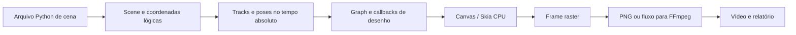

# Arquitetura

O Bamboonimation separa a **autoria**, a **amostragem temporal** e a **exportação**. Isso permite criar qualquer assunto em 2D, consultar um instante isolado e escolher a resolução de entrega depois de escrever a cena.

## Duas maneiras de desenhar

O scene graph retém objetos, hierarquias e canais de animação. Um `Group` conecta partes de um desenho; `Rig` acrescenta ossos e poses. É um caminho conveniente para personagens de recorte, objetos recorrentes e canais fáceis de inspecionar.

Os callbacks `painter(canvas,t)` desenham diretamente a composição de um frame. Eles dão liberdade para curvas e expressões que não cabem num personagem pronto: pessoas, criaturas, veículos, máquinas, ambientes e desenhos abstratos usam o mesmo contrato. Os dois caminhos podem ser combinados na mesma `Scene`.

`Sprite` oferece substituição de desenhos e `Path.morph` interpola paths com topologia compatível. Rigs não são obrigatórios e não definem o estilo visual.

## Tempo e determinismo

`Track` armazena keys ordenadas e calcula o valor num tempo absoluto. A interpolação pertence ao intervalo que chega ao key de destino. A amostragem não modifica as poses autoradas.

O código da cena deve respeitar o mesmo princípio. Integrações acumuladas, incremento de coordenadas por frame e RNG global tornam seeks e exportações com outros FPS inconsistentes. Helpers como `spring` e `walk_cycle` calculam seus resultados analiticamente. Textura e variação de traço podem usar seed fixa.

Determinismo temporal não implica que todo pixel de texto será idêntico em sistemas diferentes. Versões de Skia, fontes instaladas, codecs e arredondamento podem alterar a rasterização. Para entregas reproduzíveis, registre o ambiente e forneça assets e fontes autorizados.

## Espaços e câmera

A cena define um espaço lógico, com origem superior esquerda. Nodes criam espaços locais por translação, rotação, escala e pivô. A câmera controla centro, zoom e rotação; `Layer.depth` reduz ou mantém sua resposta nos planos da cena. A exportação aplica escala uniforme para caber na saída, com barras quando as proporções diferem.

O callback pós-composição fica no espaço da tela, útil para acabamentos de papel. Não confunda profundidade de parallax com um mundo 3D: o desenho continua sendo 2D.

## Rasterização e codificação

Skia rasteriza um frame em CPU. O renderer envia os pixels ao FFmpeg como fluxo, sem exigir armazenar um filme inteiro em RAM. FFmpeg codifica vídeo e mistura áudio. O uso de memória continua dependendo dos buffers de imagem, encoder, cache de assets e superfícies adicionais.

PNG é útil para revisão e composição externa. MP4/H.264 é uma entrega compacta opaca; WebM e ProRes suportam caminhos de transparência conforme as opções documentadas. Exportações de vídeo usam arquivo temporário e finalização no destino depois do sucesso.

Há validação prévia dos limites de coordenadas/endereço do Skia e uma estimativa conservadora dos buffers. Quando a RAM física disponível pode ser consultada no Windows/Linux, solicitações acima de 75% desse valor estimado são rejeitadas. Isso reduz erros óbvios; desenhos personalizados, caches e FFmpeg ainda podem precisar de memória extra. Não há promessa de suportar uma dimensão infinita.

## Mapa dos módulos

| Módulo | Responsabilidade |
| --- | --- |
| `animation.py` | Tracks, easing e helpers temporais |
| `drawing.py` | Vocabulário de desenho, parsing SVG path, imagens e papel |
| `scene.py` | Nodes, graph, sprites, câmera e composição |
| `rig.py` | Hierarquia de ossos, poses, IK e helpers de atuação |
| `acting.py` | Exposições variáveis e desenhos substitutos registrados |
| `deformation.py` | Warp de paths e desenhos vetoriais com transformações internas |
| `effects.py` | Impactos, hachura, rastros, velocidade e movimento secundário |
| `style.py` | Paletas e tratamento de linha/papel compartilhados |
| `storyboard.py` | Planos, tempo local, transições e composição de áudio |
| `procedural.py` | Partículas, trajetórias e cache de camadas estáticas |
| `audio.py` | Descritores de clipes, envelope e cues |
| `render.py` | Frames, sequências, encoder e relatórios |
| `preview.py` | Revisão local de frames no navegador |
| `cli.py` | Carregamento de cenas e comandos públicos |

## Limites intencionais

A biblioteca não é um modelo que inventa desenhos, um sistema de captura de movimento, um editor completo de pintura, um simulador físico geral nem um compositor com todos os recursos de produção. Ela permite programar e combinar esses elementos, importar material próprio e usar Skia diretamente quando necessário.

Não há uma sandbox para Python de terceiros. O preview executa código de cena e deve permanecer local. Veja [SECURITY.md](../SECURITY.md).